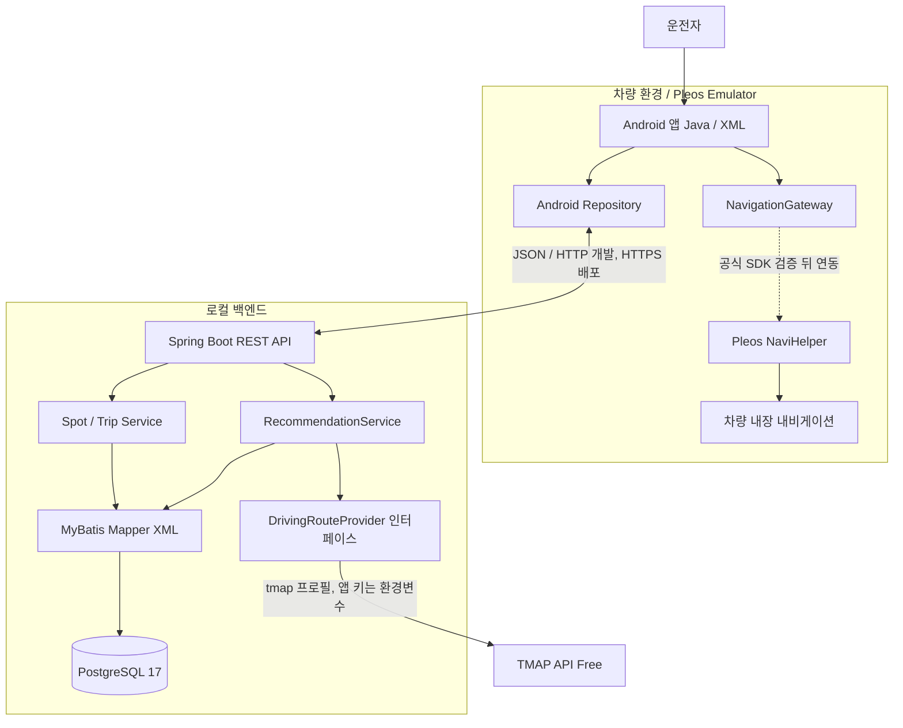

# just go 시스템 아키텍처 초안 v0.1 — Local-first / Pleos / Java / MyBatis

> 2026-10-31. 앱명·프로젝트명 `just go` [확정]. 최초 구현 전에 검증할 가정들을 명시한 설계 초안. 실동작 완료를 의미하지 않음.

## 1. 원칙

- **두 개발자 PC에서 독립 로컬 개발**. GitHub는 코드·명세를 공유하고 서버 실행 상태를 공유하지 않는다.
- Java Android 앱과 Java 21 Spring Boot 서버를 분리한다.
- 단일 백엔드 모놀리스 + PostgreSQL(RDB), MyBatis Mapper XML.
- 첫 외부 자동차 경로 PoC 제공자는 TMAP API Free로 확정했으며 인터페이스 뒤에 감춰 교체 가능성을 유지한다.
- NaviHelper는 **경유지·목적지를 차량 내비게이션에 전달**하는 용도이며, 경관 중심 코스 추천 엔진 자체가 아니다.
- NoSQL, Redis, 메시지 브로커, MSA, AWS는 초기 미사용.

## 2. 전체 구성



> 개발 환경에서만 HTTP loopback 사용. 외부 서비스 노출 시 HTTPS/TLS가 원칙이며 Android cleartext 허용을 무분별하게 확대하지 않는다.

## 3. 두 사람의 로컬 환경

- **김인영:** 두 PC에 필요한 전체 툴 설치와 공통 개발환경 세팅을 총괄하고, 서버/백엔드·DB·인프라를 소유한다.
- **정도혜:** 구성된 Android 환경에서 UI/UX·프론트엔드·Android 앱 구현을 소유한다.

```text
GitHub (하나의 저장소)
  ├─ 김인영 PC
  │   ├─ IntelliJ + Spring Boot
  │   └─ Docker Compose + PostgreSQL
  └─ 정도혜 PC
      ├─ Android Studio + Pleos Emulator
      └─ 통합 확인 시 같은 Git 저장소의 Spring Boot + PostgreSQL을 로컬로 실행
```

- 정도혜 PC에서 백엔드와 DB를 실행하는 것은 앱 통합 확인을 위한 로컬 실행일 뿐이며, 서버·DB 구현 담당은 김인영에게 있다.
- 개발 중 Android API URL은 로컬 구성에 맞게 선택. `10.0.2.2` 접근은 Pleos Emulator에서 확인한 뒤 문서화.
- 두 PC는 각각 독립 DB 데이터를 가진다. Flyway 마이그레이션과 테스트 시드로 동일한 스키마를 유지한다.
- 네트워크가 서로 달라도 각자 Mock API 또는 로컬 백엔드로 작업할 수 있다.
- 서로 다른 컴퓨터에서 실제 연결이 필요할 때만 승인된 VPN/개발 터널/동일 LAN을 쓴다. 비밀키를 터널 URL에 포함하지 않는다.
- 최종 원격 통합 시연에 안정적인 서버가 필요한 경우에만 단일 HTTPS VM 배포를 결정한다. 이 시점에는 AWS 비용·도메인·서버 보안을 재검토한다.
- 로컬 재현이 필요하면 Compose의 선택적 `app` 프로필로 PostgreSQL과 Java 21 백엔드를 함께 실행한다. 백엔드는 비루트 사용자와 loopback 포트로 실행하며, 이 구성은 HTTPS 원격 배포 완료를 의미하지 않는다.

## 4. 핵심 데이터 흐름

1. Android: 출발지(`lat`, `lon`), 시간(분), 테마, 주행 방식(`ROUND_TRIP`/`ONE_WAY`) 입력.
2. Backend: 검수된 `SPOT` 및 `SCENIC_SEGMENT`에서 후보 조회. 현재는 `SPOT`의 VERIFIED·활성·좌표 보유 후보를 Provider 요청 경계까지 전달하는 단계까지 구현.
3. Backend: 1~2개 경유지 조합과 실제 자동차 경로 API 조회.
4. Backend: 예상 주행시간, 경관 적합성, 중복 구간을 기준으로 점수화. 과거 방문 이력 활용은 P1 검토.
5. Backend → Android: 0~3개 코스와 순서가 지정된 `WAYPOINT`/`DESTINATION`, 시간·거리·추천 근거 제공.
6. Android → NaviHelper: 선택한 코스의 경유지 및 목적지 전달.
7. 이후 주행은 차량 내장 내비 담당. 외부 경로 API의 상세 선형과 동일하다고 가정하지 않는다.
8. [P1] 사용자가 동의한 범위에서 선택 코스와 드라이브 완료·취소 이력을 저장(개인정보 최소 수집).

## 5. 패키지 및 계층 제안

```text
backend/src/main/java/.../
  common/             # 공통 오류 / 요청 추적 / 설정
  route/              # Controller, Service, DTO, domain
  spot/               # 경관 장소
  trip/               # 세션 기록 (P1)
  integration/routing/ # DrivingRouteProvider, mock, 벤더별 adapter
backend/src/main/resources/
  mapper/             # MyBatis XML
  db/migration/       # Flyway
android-app/app/src/main/java/.../
  ui/                 # Activity/Fragment/XML ViewBinding
  data/               # API / DTO
  repository/         # UI ↔ 데이터 공급
  pleos/              # NavigationGateway 및 공식 SDK adapter (PoC 후)
```

MyBatis SQL은 Mapper XML에 둔다. 데이터 모델과 API DTO를 혼용하지 않는다.

## 6. 데이터 저장 설계 (아직 확정하지 않은 논리 모델)

- `SPOT`: 명소 기본 정보, 좌표, 테마, 검수 상태와 원본·이용허락·품질 근거. 출처와 세 품질 점수가 완전한 VERIFIED 행만 추천에 사용하며, V6부터 불완전한 레거시 행은 PENDING으로 전환해 DB 제약 전체를 검증함.
- `SCENIC_SEGMENT`: 실제 운전 중 경관을 감상할 수 있는 검수 도로/경유 좌표.
- `ROUTE_TEMPLATE`, `ROUTE_STOP`: 검수 코스 후보 / 순서.
- `TMAP_DAILY_CALL_USAGE`: 서울 날짜별 외부 호출 예약 건수. 앱 키·좌표·경로·응답은 저장하지 않음.
- `APP_USER`, `DRIVE_TRIP`: P1. 익명 계정·드라이브 이력 저장 범위 확정 후 생성.
- 인덱스: 테마+지역+좌표 후보 검색 패턴을 먼저 측정한 뒤 결정. 공간 검색 증가 시 PostGIS 검토.
- TMAP 경로 API 응답 원본은 영구 저장하지 않는다. 약관의 24시간 사용 제한보다 보수적으로 요청 처리 중 메모리에서만 사용한다.
- 수동 검수 후보 등록은 공개 관리 API를 만들지 않고 `candidate-import` 프로필의 로컬 JSON 가져오기로 제한한다. 실제 파일은 Git에서 제외하고 전체 검증 후 한 트랜잭션으로 반영한다.

## 7. 추천 및 경로 계산

### 추천 엔진 (규칙 기반 MVP)

- 사전 검수 경관 도로/명소 후보 선택 → 외부 경로 API로 실주행 예상 시간 계산 → 0~3개 반환.
- 초기 MVP 후보 지역은 서울·경기·인천으로 제한하고, 지역 확대는 초기 후보의 실제 경로 품질 검증 이후 결정한다.
- 외부 호출 전에 희망 시간과 주행 방식으로 계산한 보수적 직선거리 상한을 적용한다. 임시 상한 속도는 150km/h이며 왕복은 복귀 시간을 고려해 후보 반경을 절반으로 둔다. 출발 좌표와 계산 거리는 저장하거나 로그로 남기지 않는다.
- 시간 목표 오차 ±15%를 **임시 PoC 기준**으로 적용한다. LIVE 후보만 범위 안에 남기고 실제 실험 후 조정한다.
- 범위 안 후보는 목표 시간 차이, 왕복 선분 중복률, 거리, 경로 ID 순으로 안정적으로 정렬해 최대 3건 반환한다. 중복률은 TMAP GeoJSON 원시 좌표를 저장하지 않고 계산 중 정수 백분율로 축약한다.
- 후보 단계에서는 테마 적합성·풍경 품질·경유지 적합성을 임시 동일 가중치 1~5점으로 평가하고 세 항목이 모두 3점 이상인 VERIFIED 후보를 합계순으로 전달한다. 왕복 선형은 같은 무방향 선분의 재통과 거리 비율을 임시 지표로 사용하며 탈락 상한과 최종 순환 품질 가중치는 PoC 실측 후 결정한다.
- 실패 시 없는 코스를 생성하지 않는다. 실제 계산됐지만 ±15% 범위 밖이면 10~240분·5분 단위의 가까운 대체 시간을 제안하고, 선택 테마에 후보가 없으면 DB에 검수 후보가 실제 존재하는 다른 테마를 최대 3건 제안한다. 다른 테마 제안은 경로 성공을 보장하지 않으며 재검색 조건일 뿐이다.
- 예상 주행시간은 교통 상황에 따라 달라지며, 내비 재탐색에 따라 달라질 수 있다.

### Provider 추상화

```java
public interface DrivingRouteProvider {
    DrivingRouteResult calculate(DrivingRouteRequest request);
}
```

- 위 인터페이스는 현재 코드의 실제 교체 경계이며, `tmap` 프로필에서 Spring `RestClient` 기반 Provider가 활성화됩니다.
- `MockDrivingRouteProvider`는 `mock` 프로파일에서만 사용하고 UI에 `MOCK` 표시.
- `mock`과 `tmap` 프로필은 동시에 활성화할 수 없으며, 예시 앱 키는 tmap 프로필 시작 단계에서 거부한다.
- 현재 구현은 같은 테마의 검수 완료 `SPOT`을 최대 20건 Provider 요청에 전달합니다.
- TMAP 클라이언트는 경유지가 있는 왕복에 다중 경유지 30 API를, 경유지가 없는 편도에 일반 자동차 경로안내 API를 사용합니다. WGS84 좌표, timeout, 오류 분류, 거리·시간 응답 검증을 적용했습니다.
- 외부 HTTP 요청 직전에 PostgreSQL의 서울 날짜별 예약 건수를 원자적으로 증가시킵니다. 기본 90건 상한은 서버 재시작·동시 요청에도 유지되며 DB 예약이 끝난 뒤 HTTP를 호출해 외부 I/O를 DB 트랜잭션 안에 묶지 않습니다.
- TMAP Provider는 무료 쿼터 보호를 위해 전달된 후보 중 앞의 최대 3건만 계산합니다. `ROUND_TRIP`은 후보를 경유해 출발지로 복귀하고 `ONE_WAY`는 후보를 도착지로 사용합니다.
- LIVE 응답은 Android가 내비 전달 순서를 구성할 수 있도록 지점 순서·역할·이름·WGS84 좌표를 별도 DTO로 반환합니다. 왕복 출발 좌표는 응답에 필요한 동안만 사용하고 저장·로그 기록하지 않습니다. MOCK은 가짜 좌표를 만들지 않고 빈 지점 목록을 반환합니다.
- 외부 호출 오류는 원시 응답이나 키를 노출하지 않고 인증·쿼터는 HTTP 503, 그 밖의 제공자 오류는 HTTP 502로 변환합니다.
- Provider 연결은 모의 HTTP·단위 테스트까지만 검증했습니다. 목표 시간 ±15% 필터·정렬은 서비스 계층에 구현했으며, 실제 앱 키 호출과 세부 경관·순환 품질 점수는 아직 미검증·미구현입니다.

## 8. 외부 및 차량 SDK PoC (구현 우선순위)

1. Android Java 앱이 Pleos Emulator에서 시작되는가?
2. NaviHelper로 단일 목적지와 다중 경유지를 전달할 수 있는가?
3. 현재 위치/수동 출발지 입력이 에뮬레이터에서 가능한가?
4. Spring Boot에서 업체의 실제 자동차 경로 API로 왕복 예상시간/거리를 받을 수 있는가?
5. API가 제공한 경유지를 내비로 넘겼을 때 코스가 의도한 풍경 경로를 대체로 유지하는가?
6. Vehicle SDK는 필수 아님. 운행·배터리 관련 데이터는 별도 권한·Capability 검증 뒤 결정.

## 9. 데이터·API 보안

- 백엔드의 외부 API 키는 Android에 노출하지 않는다.
- 타임아웃, 예외 매핑, 검증, 요청량 상한 설정.
- 정확한 사용자 위치는 필수 목적 외 저장·로그 기록하지 않는다.
- 익명 사용자 토큰 및 드라이브 이력 영구 저장의 구현 여부는 별도 승인 후 결정.
- 목표 앱 카테고리는 **Mobility Services**로 결정. 실제 카테고리 등록·심사 적합성 및 앱 선언 규칙은 공식 검증 필요. 주행 중 복잡 조작 UI는 제한한다.

## 10. 테스트·운영 및 배포 의사결정

- Backend: JUnit 5 / Mock Provider 단위 테스트, 필요 시 Testcontainers PostgreSQL 통합 테스트.
- Android: 일반 Android 빌드와 **Pleos Emulator 실제 실행 검증을 구분**하여 보고.
- API 계약: `docs/api-contract.yaml`에서 요청/응답 명세 공유. 미구현 API는 예시로만 표시.
- 장애/관측: Actuator health, `traceId`, 민감정보 없는 오류 로그부터.
- AWS 배포 **미결정/미필수**. 초기에는 별도 인프라 예산 0원 지향.
- 시연 영상은 실제 차량 없이 **Pleos Emulator 화면 녹화**로 가능. 1차 선택 제출이지만 2차에서는 실행 가능한 앱 시연이 필수.

## 11. 검증 근거

- Pleos Emulator 요구사항: https://document.pleos.ai/docs/connect/guide/getting-started/application-development/setup-connect-sdk-emulator
- NaviHelper: https://document.pleos.ai/docs/pleos-only/connect-sdk-pleos/NaviHelper/intro
- 공모전 제출: https://appdevchallenge.auto-hmg.io/guide/submission
- 공모전 참가 규정: https://appdevchallenge.auto-hmg.io/guide/rules
