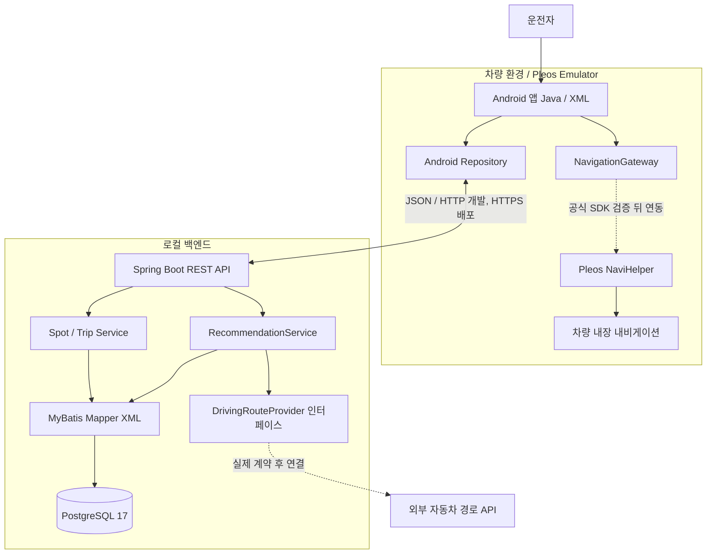

# just go 시스템 아키텍처 초안 v0.1 — Local-first / Pleos / Java / MyBatis

> 2026-10-31. 앱명·프로젝트명 `just go` [확정]. 최초 구현 전에 검증할 가정들을 명시한 설계 초안. 실동작 완료를 의미하지 않음.

## 1. 원칙

- **두 개발자 PC에서 독립 로컬 개발**. GitHub는 코드·명세를 공유하고 서버 실행 상태를 공유하지 않는다.
- Java Android 앱과 Java 21 Spring Boot 서버를 분리한다.
- 단일 백엔드 모놀리스 + PostgreSQL(RDB), MyBatis Mapper XML.
- 외부 자동차 경로 API는 인터페이스 뒤에 감춘다. 업체 미확정.
- NaviHelper는 **경유지·목적지를 차량 내비게이션에 전달**하는 용도이며, 경관 중심 코스 추천 엔진 자체가 아니다.
- NoSQL, Redis, 메시지 브로커, MSA, AWS는 초기 미사용.

## 2. 전체 구성



> 개발 환경에서만 HTTP loopback 사용. 외부 서비스 노출 시 HTTPS/TLS가 원칙이며 Android cleartext 허용을 무분별하게 확대하지 않는다.

## 3. 두 사람의 로컬 환경

```text
GitHub (하나의 저장소)
  ├─ 김인영 PC
  │   ├─ IntelliJ + Spring Boot
  │   └─ Docker Compose + PostgreSQL
  └─ 정도혜 PC
      ├─ Android Studio + Pleos Emulator
      └─ 필요 시 같은 Git 저장소의 Spring Boot + PostgreSQL을 로컬로 실행
```

- 개발 중 Android API URL은 로컬 구성에 맞게 선택. `10.0.2.2` 접근은 Pleos Emulator에서 확인한 뒤 문서화.
- 두 PC는 각각 독립 DB 데이터를 가진다. Flyway 마이그레이션과 테스트 시드로 동일한 스키마를 유지한다.
- 네트워크가 서로 달라도 각자 Mock API 또는 로컬 백엔드로 작업할 수 있다.
- 서로 다른 컴퓨터에서 실제 연결이 필요할 때만 승인된 VPN/개발 터널/동일 LAN을 쓴다. 비밀키를 터널 URL에 포함하지 않는다.
- 최종 원격 통합 시연에 안정적인 서버가 필요한 경우에만 단일 HTTPS VM 배포를 결정한다. 이 시점에는 AWS 비용·도메인·서버 보안을 재검토한다.

## 4. 핵심 데이터 흐름

1. Android: 출발지(`lat`, `lon`), 시간(분), 테마, 왕복 여부 입력.
2. Backend: 검수된 `SPOT` 및 `SCENIC_SEGMENT`에서 후보 조회.
3. Backend: 1~2개 경유지 조합과 실제 자동차 경로 API 조회.
4. Backend: 예상 주행시간, 경관 적합성, 중복 구간을 기준으로 점수화. 과거 방문 이력 활용은 P1 검토.
5. Backend → Android: 0~3개 코스와 경유지 목록, 시간·거리·추천 근거 제공.
6. Android → NaviHelper: 선택한 코스의 경유지 및 목적지 전달.
7. 이후 주행은 차량 내장 내비 담당. 외부 경로 API의 상세 선형과 동일하다고 가정하지 않는다.
8. [P1] 사용자가 동의한 범위에서 선택 코스와 드라이브 완료·취소 이력을 저장(개인정보 최소 수집).

## 5. 패키지 및 계층 제안

```text
backend/src/main/java/.../
  common/             # 공통 오류 / 요청 추적 / 설정
  route/              # Controller, Service, DTO, domain
  spot/               # 경관 장소
  trip/               # 세션 기록 (P1)
  integration/routing/ # DrivingRouteProvider, mock, 벤더별 adapter
backend/src/main/resources/
  mapper/             # MyBatis XML
  db/migration/       # Flyway
android-app/app/src/main/java/.../
  ui/                 # Activity/Fragment/XML ViewBinding
  data/               # API / DTO
  repository/         # UI ↔ 데이터 공급
  pleos/              # NavigationGateway 및 공식 SDK adapter (PoC 후)
```

MyBatis SQL은 Mapper XML에 둔다. 데이터 모델과 API DTO를 혼용하지 않는다.

## 6. 데이터 저장 설계 (아직 확정하지 않은 논리 모델)

- `SPOT`: 명소 기본 정보, 좌표, 테마.
- `SCENIC_SEGMENT`: 실제 운전 중 경관을 감상할 수 있는 검수 도로/경유 좌표.
- `ROUTE_TEMPLATE`, `ROUTE_STOP`: 검수 코스 후보 / 순서.
- `APP_USER`, `DRIVE_TRIP`: P1. 익명 계정·드라이브 이력 저장 범위 확정 후 생성.
- 인덱스: 테마+지역+좌표 후보 검색 패턴을 먼저 측정한 뒤 결정. 공간 검색 증가 시 PostGIS 검토.
- 경로 API 응답 원본 저장은 금지부터 시작해 제공사 약관 확인 후 필요한 범위만 허용한다.

## 7. 추천 및 경로 계산

### 추천 엔진 (규칙 기반 MVP)

- 사전 검수 경관 도로/명소 후보 선택 → 외부 경로 API로 실주행 예상 시간 계산 → 0~3개 반환.
- 시간 목표 오차 ±15%는 **초기 가설**. 실제 실험으로 조정.
- 추천 점수는 목표 주행시간, 테마 적합도, 순환 코스 품질을 중심으로 검토한다. 가중치는 PoC 실측 데이터 확인 후 결정한다.
- 실패 시 대체 시간/테마를 제안하고 없는 코스를 생성하지 않는다.
- 예상 주행시간은 교통 상황에 따라 달라지며, 내비 재탐색에 따라 달라질 수 있다.

### Provider 추상화

```java
public interface DrivingRouteProvider {
    DrivingRouteResult calculate(DrivingRouteRequest request);
}
```

- 위 코드는 설계 수준의 인터페이스 예시이며 구현/호환 라이브러리는 미선정.
- `MockDrivingRouteProvider`는 `mock` 프로파일에서만 사용하고 UI에 `MOCK` 표시.
- 유료 API·무료 쿼터·위도/경도 좌표계·다중 경유지·배포 허가·저장 제한을 검증하기 전 벤더 확정 금지.

## 8. 외부 및 차량 SDK PoC (구현 우선순위)

1. Android Java 앱이 Pleos Emulator에서 시작되는가?
2. NaviHelper로 단일 목적지와 다중 경유지를 전달할 수 있는가?
3. 현재 위치/수동 출발지 입력이 에뮬레이터에서 가능한가?
4. Spring Boot에서 업체의 실제 자동차 경로 API로 왕복 예상시간/거리를 받을 수 있는가?
5. API가 제공한 경유지를 내비로 넘겼을 때 코스가 의도한 풍경 경로를 대체로 유지하는가?
6. Vehicle SDK는 필수 아님. 운행·배터리 관련 데이터는 별도 권한·Capability 검증 뒤 결정.

## 9. 데이터·API 보안

- 백엔드의 외부 API 키는 Android에 노출하지 않는다.
- 타임아웃, 예외 매핑, 검증, 요청량 상한 설정.
- 정확한 사용자 위치는 필수 목적 외 저장·로그 기록하지 않는다.
- 익명 사용자 토큰 및 드라이브 이력 영구 저장의 구현 여부는 별도 승인 후 결정.
- 목표 앱 카테고리는 **Mobility Services**로 결정. 실제 카테고리 등록·심사 적합성 및 앱 선언 규칙은 공식 검증 필요. 주행 중 복잡 조작 UI는 제한한다.

## 10. 테스트·운영 및 배포 의사결정

- Backend: JUnit 5 / Mock Provider 단위 테스트, 필요 시 Testcontainers PostgreSQL 통합 테스트.
- Android: 일반 Android 빌드와 **Pleos Emulator 실제 실행 검증을 구분**하여 보고.
- API 계약: `docs/api-contract.yaml`에서 요청/응답 명세 공유. 미구현 API는 예시로만 표시.
- 장애/관측: Actuator health, `traceId`, 민감정보 없는 오류 로그부터.
- AWS 배포 **미결정/미필수**. 초기에는 별도 인프라 예산 0원 지향.
- 시연 영상은 실제 차량 없이 **Pleos Emulator 화면 녹화**로 가능. 1차 선택 제출이지만 2차에서는 실행 가능한 앱 시연이 필수.

## 11. 검증 근거

- Pleos Emulator 요구사항: https://document.pleos.ai/docs/connect/guide/getting-started/application-development/setup-connect-sdk-emulator
- NaviHelper: https://document.pleos.ai/docs/pleos-only/connect-sdk-pleos/NaviHelper/intro
- 공모전 제출: https://appdevchallenge.auto-hmg.io/guide/submission
- 공모전 참가 규정: https://appdevchallenge.auto-hmg.io/guide/rules
